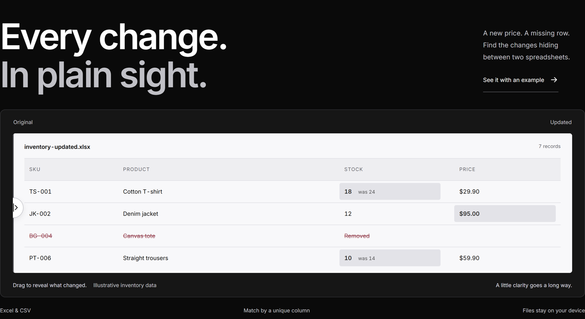

# Sheet Diff

Compare two Excel or CSV files and see what changed, right in your browser.

Sheet Diff matches records using a shared unique identifier, such as a SKU, code or email. Rows and columns can move between versions without losing the connection between records.



## Features

- Compare `.xlsx` and UTF-8 `.csv` files, including worksheet selection for Excel files.
- Find changed, added, removed and unchanged records, plus added or removed columns.
- Review original and updated values together, filter by status and search records.
- Export the full comparison to Excel, independently of the current filter.
- Explore a built-in inventory example and a draggable before-and-after preview.
- Process spreadsheet data locally in the browser, with bundled scripts and fonts.

## Try it locally

No build step or backend is required. With Python 3 installed:

```sh
git clone https://github.com/VitorRodi/sheet-diff.git
cd sheet-diff
python -m http.server 4180 --bind 127.0.0.1 --directory dist
```

Open [localhost:4180](http://localhost:4180) and click **Try the inventory example**, or select your own files. Any static HTTP server can serve `dist/`.

## Development and tests

Node.js 22 or newer is recommended for the development tools.

```sh
npm ci
npm test
```

Generate sample Excel files and an invalid-key CSV fixture:

```sh
node fixtures.mjs
```

The files are written to `examples/`. Compare `original.xlsx` with `updated.xlsx` using **SKU**, export the results, then optionally verify that export:

```sh
node verify-export.mjs /path/to/sheet-diff-comparison.xlsx
```

The static ExcelJS bundle is committed so the app runs without downloading a library at runtime. After an intentional dependency update, copy `node_modules/exceljs/dist/exceljs.min.js` to `dist/vendor/exceljs.min.js` and retain its license.

## Comparison rules and limits

The first row contains column headers. Choose a shared column with a nonempty, unique value for each record. Duplicate or blank identifiers stop comparison rather than silently dropping records.

Identifier whitespace is trimmed. Other values are compared as exact strings, including case and whitespace. Dates use ISO strings. Formulas require saved calculation results. Formatting, comments, macros and formulas themselves are not compared.

Limits: **5 MB per file**, **10,000 data rows** and **100 columns per worksheet**. CSV supports comma, semicolon and tab delimiters, quoted fields, escaped quotes, multiline values and a UTF-8 BOM. Legacy `.xls` files are not supported.

## Structure

```text
dist/                 Static application, ready to serve
  core.mjs            CSV parsing and record comparison
  app.mjs             File loading, results, search and Excel export
  design.mjs          Interactive preview and demo controls
  vendor/             ExcelJS and local Inter fonts, with licenses
tests/                Node.js comparison and CSV tests
examples/             Generated sample files
docs/                 Product screenshots
```

## Privacy

Spreadsheet contents are read, compared and exported in your browser. The app has no spreadsheet-upload endpoint or analytics integration. A host serving the static site may keep normal access logs; those requests do not contain spreadsheet contents.

## Contributing

Issues and pull requests are welcome. See [CONTRIBUTING.md](CONTRIBUTING.md). Please use synthetic data in examples and bug reports.

## License and author

MIT license. See [LICENSE](LICENSE) and [THIRD_PARTY_NOTICES.md](THIRD_PARTY_NOTICES.md).

Built by [Vitor Rodi](https://github.com/VitorRodi).
